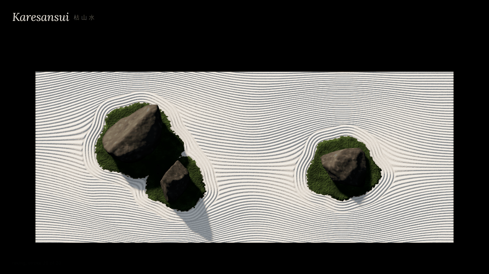

# Karesansui 枯山水

[](loop/karesansui-loop.mp4)

<sub>12-second loop. Click for the MP4 (1280×720, 0.65 MB); the GIF above is 1280×720, 0.9 MB.</sub>

A dry Zen garden in the browser: raked white gravel, a few dark stones on moss islands, low dawn light. The rake lines are not drawn. They are the level lines of a field that flows around each stone. Tap the gravel to set a stone, drag a stone to move it, double-tap a stone to take it away. When something changes, an unseen monk re-rakes the garden one stroke at a time.

## Open it

Open `karesansui.html` in a recent browser. It is a single 60 kB file; it loads three.js 0.147.0 from jsDelivr and Lora and Inter from Google Fonts, and everything else is inline.

- **Tap** the gravel to set a stone (at most seven; an eighth lets the eldest go).
- **Drag** a stone to move it. The monk waits while you hold it.
- **Double-tap** a stone to take it away.
- **Sound** (bottom right, off by default): very quiet raking.
- **How it works** (top right) explains the field, the monk and the light; × or <kbd>Esc</kbd> closes it.
- With `prefers-reduced-motion`, re-raking is instant, stones appear and disappear without animation, and the sun stays still.

## How it works

**The field.** Each stone has a moss island whose edge is a circle with a few low harmonics, `r = m (1 + Σ aₖ sin(kθ + φₖ))`. The signed distances to all islands are joined with a polynomial smooth-min, so two stones close together share one peanut-shaped set of ripples, as at Ryōan-ji. Within four groove periods of that union, the groove phase is the distance itself (concentric rings). Outside it, the phase is a stream function: straight lines along the long side, bent by the flow round a cylinder of the ring band's radius,

```
ψ = z − S Σ wᵢ (z − zᵢ) Rᵢ² / rᵢ²,   wᵢ = falloff(rᵢ) / max(1, Σ falloff)
```

The falloff keeps each stone's influence local, and dividing by the summed falloff where reaches overlap blends neighbouring stones' deflections instead of adding them. Lines that would enter a ring band end in its outer groove, the way they butt into the rings in real gardens. Groove height is a slightly sharpened cosine of the phase, with a small per-stroke amplitude and wobble and a little grain noise.

**The gravel remembers.** Height lives in a half-float render target, and a stroke is a draw into that texture. The fragment shader evaluates the field for the current stones and writes height only where the texel belongs to that stroke and lies between the rake's previous and current positions (soft-edged, alpha-blended, never read back). Each stroke feathers over two texels beyond its sides, so the seam between fresh and old gravel is antialiased. Everything not yet raked keeps its old pattern, so a moved stone leaves a ghost, rings round nothing and a flat patch where its moss was, until the monk reaches them.

**The monk.** A change marks the stones whose ring band it touches and the bands of straight lines it can reach (a band is one rake width, four tines). Rings go first, then bands from the far side to the near side, alternating direction like someone walking back and forth. A stroke takes about two seconds, with a short pause between strokes. A full re-rake after one change is roughly 20 to 25 strokes, about a minute.

**Resizing.** Ordinary resizes (a phone's toolbar sliding away, a window dragged a little wider) refit the camera and keep the gravel's memory and the monk's queue. Only a turn between portrait and landscape, or a change in on-screen density beyond 0.8–1.25×, rebuilds the height texture and rakes everything again at once.

**Light.** The gravel is a `MeshStandardMaterial` patched in `onBeforeCompile`: normals from central differences of the height texture, plus a fine grain normal that fades out below pixel size. Grooves shadow each other by marching four steps toward the sun through the height texture, and valleys, edges and stone contacts get ambient occlusion. Stones cast soft PCF shadows from a low warm sun (about 20°, drifting a few degrees over minutes) with a cool sky fill and ACES tone mapping.

**Frame cost.** Nothing is drawn unless something changed: a stroke was painted, a stone moved, the page was resized, or the sun stepped (once a second, by hundredths of a degree). When the sun or a stone moves, one pass redraws the shadow map and bakes the stones' shadows on the bed into a half-resolution texture that the gravel reads with one tap. So while the monk rakes, a frame is the gravel shader plus the stones, and an idle garden draws one frame a second.

**Stones.** Each stone is a sphere whose radius in every direction is the soft-min of the distances to 16 to 22 random planes, giving a chiselled convex rock with rounded edges. Faint strata, fbm weathering, vertex-colour lichen, moss and occlusion near the base go on top, with a small procedural bump for grit. A third of each stone is buried. Stones rise out of the gravel when set and sink back when removed.

**Sound.** Looped noise with sparse pebble ticks through high-pass, band-pass and low-pass filters, louder mid-stroke and panned with the rake head.

## Limits

- **Frame time is measured on one Mac only.** On an Apple M5 Pro (Chromium 152, ANGLE Metal; GPU-synced timing of the render passes, median of 5 runs, 2026-11-06), a frame while the monk rakes took 2.27 ms at 1440×900 at 2× density (worst 4.0 ms) and 1.8 ms at 375×812 at 2× (worst 2.7 ms); a frame where the sun or a stone moved took 2.9 ms and 2.67 ms. That leaves a wide margin under the 16.7 ms a 60 fps frame allows, but it was not checked as a live, on-screen frame rate, and not on a phone GPU: weak mobile GPUs at DPR 2 are still the risk while the monk rakes. (Headless software WebGL, used for the screenshots, takes about one to one and a half seconds per frame.)
- Rotating between portrait and landscape, or resizing the garden by more than about 20–25% on screen, re-rakes everything instantly, and a re-rake in progress is lost. In portrait the garden turns 90° so the lines still run along its long side.
- The flow is a blend of single-cylinder flows, not an exact multi-body solution. Lines still squeeze against the long walls when a stone sits close to one (most visible in portrait).
- Band seams are real seams: where a fresh stroke meets old gravel the grooves jump, as in raked gravel, softened over two texels.
- Stone shadows come from one 2048² map over the whole garden, so they are soft, and a stone's shadow on a neighbouring stone starts slightly late.
- Without `EXT_color_buffer_float` the height texture falls back to 8 bits, and the groove normals will band.
- Stones are generated from presets and seeds. They read as stones, but they are not individually composed like Ryōan-ji's.

## In this repository

- `karesansui.html`: the piece (there is no build step)
- `screenshots/`: the garden, a re-rake in progress, and the phone layout
- `loop/`: the loop video, its GIF and a poster

The headless check and benchmark scripts are not in this repository yet.

## Credits and license

three.js is MIT; the fonts are under the SIL Open Font License.

Code: MIT. See [LICENSE](LICENSE).

Built with Claude for Joe Gao.
